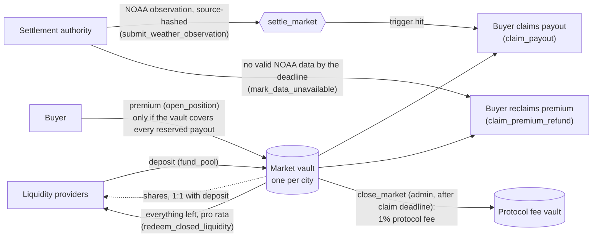

# SkyHedge: weather protection you buy from your phone

> **Parametric weather protection on Solana, built for the Seeker.** Pick a place and a weather risk, see a quote priced from NOAA data, approve it in your wallet, and get paid on-chain automatically when the weather data shows the trigger was hit. No claims adjuster, no paperwork.
>
> Solana Mobile **Clock In** hackathon entry · native React Native Android app (not a PWA) · Solana Devnet · Mobile Wallet Adapter.

| | |
|---|---|
| Repo (submission branch) | [msourial/SkyHedge-Sol @ clock-in-submission](https://github.com/msourial/SkyHedge-Sol/tree/clock-in-submission) |
| APK | See [Releases](https://github.com/msourial/SkyHedge-Sol/releases) (debug-signed Devnet build; SHA-256 in the release notes and [docs/takeover-log.md](docs/takeover-log.md)) |
| Hackathon | [Solana Mobile Clock In](https://solanamobile.radiant.nexus/) · submitted on Align |
| Demo | `<<DEMO_VIDEO_URL>>` · script: [docs/demo-script.md](docs/demo-script.md) |
| Pitch deck | [docs/clock-in-pitch.pdf](docs/clock-in-pitch.pdf) |
| Program (Devnet) | `5hGLEG1ts46iER4pfWnP1fMb8sG5nxSinNY1pjYnNPWx` |
| Test token | `SKYT` mint `3Y1SaGnJiPez3hkcHom2gimtVEm7W7R8imeRMPTUaK9g` (Devnet, no value) |

**On-chain proof:** a real `OpenPosition` purchase from the Seeker through Phantom, finalized on Devnet:
[`5TjACP1S…7qsPWycH`](https://explorer.solana.com/tx/5TjACP1ScQxXRP4GNpA5zXqxAHK2iCNvcETPx1z7rJ4qXPjMWXZ6qXgngHjrPGv9sVL1h6nGULmzwCiu7qsPWycH?cluster=devnet)

## Why

Weather decides whether a flight leaves, a crane lifts, a haul road stays open, an outdoor wedding happens, or a harvest pays. Traditional weather cover is slow, paperwork-heavy, sold in large minimum sizes, and out of reach for most small operators. SkyHedge is **instant** (quote and buy in under a minute), **accessible** (a phone and a wallet are enough), and **fractional** (no minimum policy size).

- **Aviation (lead wedge):** operators, flight schools and charters that lose revenue on weather days.
- **Agriculture (the heart of the story):** the farmer whose season depends on rainfall they can't control.
- Also: construction, mining, and events and weddings.

**Business model:** a **1% protocol fee** on every purchase, included in the quoted premium and shown on the ticket. SkyHedge is pre-launch, so no traction numbers are claimed.

## Key features

- **Protect flow:** choose coverage of **50 / 100 / 250 / Max SKYT** (paid if triggered). A labelled **Rain trigger** row shows the threshold in mm. The quote appears as an option ticket listing what you pay, what you get, the trigger, the window, the chance and the fee. Then tap **Review in wallet**.
- **Markets:** a hero card with **live NOAA rainfall** and a **7-week chart**. **Des Moines, Iowa** (cumulative rainfall) is live. **Toronto** shows as **"Opens soon"** and its Environment Canada adapter is already in the codebase.
- **Phantom via Mobile Wallet Adapter on Devnet:** the server builds the transaction unsigned, and the user approves it in their wallet. Nothing is signed without the user.
- **On-chain positions** through the Anchor program, **one per wallet per market window**. After purchase the app shows "You're protected" with the finalized status and an **Explorer link**.
- **Settlement:** the final observation is normalized, hashed and committed on-chain. If the trigger is hit, the buyer claims the fixed payout. If source data is unavailable after a 7-day grace period, the market resolves `DATA_UNAVAILABLE` and premiums are refundable. SkyHedge never makes up weather values.
- **Built for mobile networks:** API reads retry with timeouts. Balances are read directly from Solana RPC with a fallback to a second Devnet endpoint (genesis-hash checked). Friendly errors and an offline state with Retry replace endless spinners.

## How it works

```
Pick place + risk  →  NOAA / Environment Canada data  →  quote (premium, payout, chance)
      →  approve in wallet (MWA)  →  Anchor program on Devnet holds premium + vault
      →  final observation hashed on-chain  →  automatic payout or premium refund
```

Pricing uses ten analogous NOAA windows plus a forecast signal, a 15% risk load and the 1% fee. Markets come from a per-market counter, and city, station and provider are stored as hashes, so **adding Toronto needs no program change** (see [docs/canadian-market-plan.md](docs/canadian-market-plan.md)).

## Money flow

Each city market has its own fully collateralized vault (a PDA-owned SPL token account). Liquidity providers take the other side of every protection position; there is no order book or outside insurer. Everything below is enforced by `anchor/programs/skyhedge_protection/src/lib.rs`.



- **Funding.** Any wallet can `fund_pool` while a market is Draft or Open and before sales close, up to the market's liquidity cap; LP shares are 1:1 with SKYT deposited. `withdraw_liquidity` is allowed in the same window only if the vault still covers reserved exposure.
- **Buying.** `open_position` charges `premium = ceil(protected_amount × premium_rate_bps / 10,000)`, where `premium_rate_bps = ceil(probability_bps × 1.15) + 100`. The 1% protocol fee (1% of the protected amount) is part of the premium and is only accrued, not moved. The purchase reserves the full payout and is rejected unless the vault, including the new premium, covers all reserved exposure and stays within the market's exposure and per-wallet caps.
- **Settlement.** The settlement authority posts one NOAA observation that must match the market's station hash, methodology hash and window and carry a non-zero source hash; `settle_market` compares it with the immutable trigger. If the trigger is not hit, premiums stay in the vault for LPs. If no valid NOAA data exists after the data deadline, `mark_data_unavailable` lets every buyer reclaim their full premium and waives the protocol fee.
- **Close.** After the claim deadline the admin calls `close_market`: the accrued 1% fee moves to the protocol fee vault (zero when data was unavailable) and everything left in the vault is redeemable by LPs pro rata.
- **Who signs.** The protocol admin wallet creates, opens (needs at least one LP share) and closes markets; the settlement authority posts observations; LPs and buyers sign their own deposits, purchases and claims. Funding is not admin-gated on chain; on Devnet the admin wallet seeds the first liquidity.
- **Collateral.** Devnet uses the valueless six-decimal SKYT test token; no real money is involved.

## Install

**APK:** download it from [Releases](https://github.com/msourial/SkyHedge-Sol/releases). A release for build `e5ca97a` is coming. Install with `adb install SkyHedge-ClockIn.apk` or sideload it on the Seeker.

**Wallet setup:** in Phantom, open Settings → Developer Settings, turn on **Testnet Mode**, and set Solana to **Devnet**. You need Devnet SOL for fees and SKYT for premiums.

**Build from source:**

```bash
npm install
npm run check          # typecheck (root)
npm run test:server    # server tests

cd mobile
npm install
npm run check          # typecheck (mobile)
npm run test:mobile    # mobile tests (67 passing)
EXPO_PUBLIC_API_BASE_URL=https://skyhedge.vercel.app npx expo prebuild --platform android
cd android && EXPO_PUBLIC_API_BASE_URL=https://skyhedge.vercel.app ./gradlew assembleRelease
# → android/app/build/outputs/apk/release/app-release.apk
```

`EXPO_PUBLIC_API_BASE_URL` is baked in at build time and falls back to `https://skyhedge.vercel.app`. `EXPO_PUBLIC_SKYT_MINT` can override the SKYT mint. For the full developer reference (env vars, localnet, Devnet activation, API, security posture), see [docs/developer-reference.md](docs/developer-reference.md).

## Tech stack

- **Mobile:** Expo / React Native (Android), `@solana-mobile/mobile-wallet-adapter-protocol-web3js`, `@solana/web3.js`
- **Chain:** Anchor program `skyhedge_protection` on Solana Devnet, SPL token SKYT
- **Server:** Node / Express (TypeScript): quote engine, NOAA and ECCC providers, evidence builder, unsigned-transaction builder, settlement runner. Deployed on Vercel.
- **Web:** React + Vite operator console

## Repo layout

```
mobile/    Expo / React Native Android app (Markets · Protect · Wallet), MWA, direct Solana RPC reads
server/    Express API: quote engine, NOAA + ECCC providers, evidence, unsigned-tx builder, settlement
anchor/    Anchor program skyhedge_protection (markets, vaults, positions, settlement, claims)
client/    Web companion / operator console (React + Vite), skyhedge.vercel.app
shared/    IDL, methodology, optional Postgres schema
docs/      demo script, pitch deck, submission draft, plans, takeover log
```

## Tests

- `cd mobile && npm run test:mobile`: **67 passing** (wallet auth and send, ticket, chain fallback, network resilience, option copy, and more)
- `npm run test:server`: server suite (quote engine, NOAA/ECCC providers, settlement)
- `npm run check`: typecheck clean for both root and mobile

## Status & honesty

Devnet only. SKYT is a test token. This is not insurance and not a regulated product. No traction numbers are claimed.

## License

[MIT](LICENSE)
