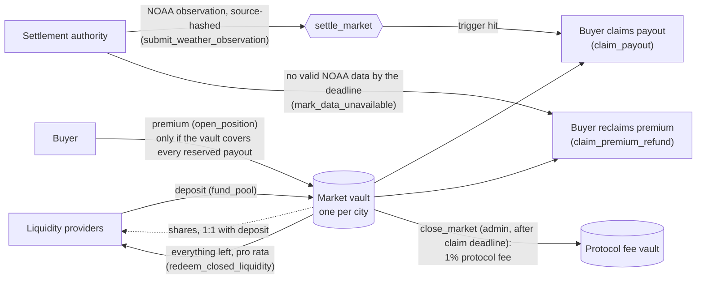
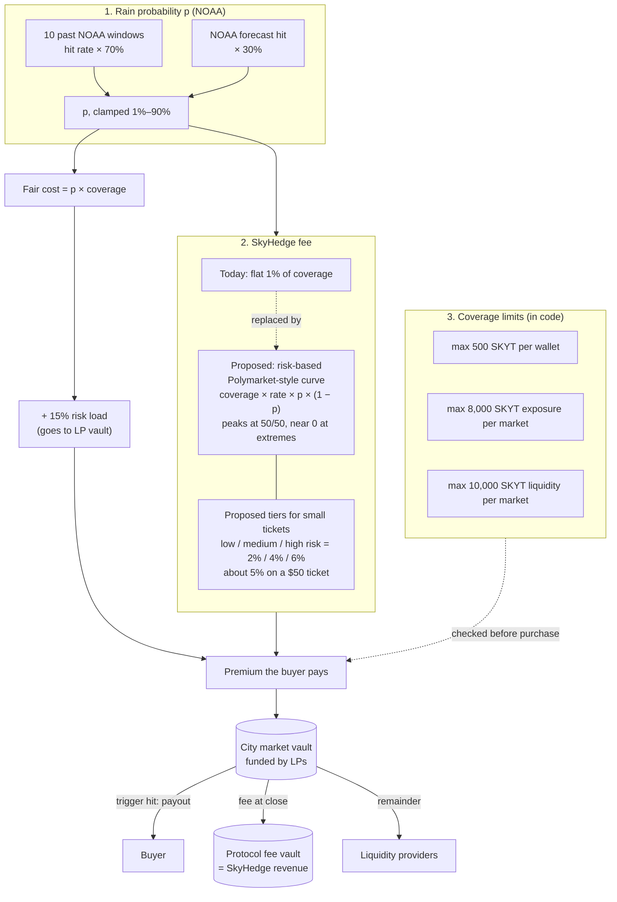

# SkyHedge: weather protection you buy from your phone

> **Parametric weather protection on Solana.** Pick a place and a weather risk, see a quote priced from NOAA data, approve it in your wallet, and get paid on-chain automatically when the weather data shows the trigger was hit. No claims adjuster, no paperwork.
>
> **Encode Club Solana Hackathon 2026** entry · native React Native Android app (built for the Solana Seeker) · Solana Devnet · Mobile Wallet Adapter.

| | |
|---|---|
| Hackathon | Encode Club Solana Hackathon 2026 · readiness checklist: [docs/encode-readiness.md](docs/encode-readiness.md) |
| Tracks | **Best Consumer App on Solana** · **Best Use of x402 on Solana** (x402 is *planned / under evaluation*, not integrated; see below) |
| Repo | [msourial/SkyHedge-Sol @ seeker-revamp](https://github.com/msourial/SkyHedge-Sol/tree/seeker-revamp) |
| APK | See [Releases](https://github.com/msourial/SkyHedge-Sol/releases) (Devnet build; SHA-256 in the release notes) |
| Demo | `<<DEMO_VIDEO_URL>>` · script: [docs/demo-script.md](docs/demo-script.md) |
| Pitch deck | `<<PITCH_DECK_URL>>` (previous deck: [docs/clock-in-pitch.pdf](docs/clock-in-pitch.pdf)) |
| Program (Devnet) | `5hGLEG1ts46iER4pfWnP1fMb8sG5nxSinNY1pjYnNPWx` |
| Test token | `SKYT` mint `3Y1SaGnJiPez3hkcHom2gimtVEm7W7R8imeRMPTUaK9g` (Devnet, no value) |

**On-chain proof:** a real `OpenPosition` purchase from the Seeker through Phantom, finalized on Devnet:
[`5TjACP1S…7qsPWycH`](https://explorer.solana.com/tx/5TjACP1ScQxXRP4GNpA5zXqxAHK2iCNvcETPx1z7rJ4qXPjMWXZ6qXgngHjrPGv9sVL1h6nGULmzwCiu7qsPWycH?cluster=devnet)

> **History:** SkyHedge was first built for the Solana Mobile **Clock In** hackathon (October 2026). That entry's notes remain in [docs/clock-in-readiness.md](docs/clock-in-readiness.md) and [docs/clock-in-submission-draft.md](docs/clock-in-submission-draft.md).

## For judges

**What it is.** SkyHedge sells parametric weather protection: a fixed payout that triggers automatically when public weather data crosses a pre-set threshold (for example, at least 50 mm of rain in Des Moines over a 7-day window). There is no claims process; the data decides.

**How Solana powers it.**
- **Anchor program** (`anchor/programs/skyhedge_protection`) holds every rule: market creation, pricing inputs, purchases, settlement, payouts and refunds.
- **Per-market vaults:** each city market has its own fully collateralized, PDA-owned token vault. A purchase is rejected unless the vault covers every reserved payout.
- **SKYT** is a valueless six-decimal Devnet test token used as collateral; no real money is involved.
- **Mobile Wallet Adapter + Phantom:** the server builds the transaction unsigned and the user approves it in Phantom on the phone. Nothing is signed without the user.
- **Settlement:** the final NOAA observation is normalized, hashed and committed on-chain; if the trigger is hit the buyer claims the payout, and if data is unavailable premiums are refundable.

**How to test.**
1. Install the Android APK from [Releases](https://github.com/msourial/SkyHedge-Sol/releases) on a Seeker or any Android phone.
2. Install Phantom and switch it to **Devnet**. You need a little Devnet SOL for fees and some SKYT test tokens to buy protection.
3. Open SkyHedge → **Markets** → pick a city → **Protect** → choose coverage → **Review in wallet** and approve in Phantom.
4. The app shows the finalized position with an Explorer link. Without SKYT you can still browse markets, quotes and live NOAA data.

**Current live status (Devnet).**
- **Des Moines, Iowa:** live market; its observation window runs until **Oct 18, 2026, 8:00 PM ET**. Its sales window has closed, so new purchases need a new window.
- **Chicago, New York and Miami:** ready to open; each needs an on-chain market creation and funding by the admin wallet.
- **Toronto:** opens soon (Environment Canada adapter is in the codebase).

**x402 (Best Use of x402 track).** x402 is **not integrated yet**. It is planned and under evaluation, for example for pay-per-request access to premium weather feeds. Today the app only checks a free WeatherXM health endpoint, and x402-paid data is never used for settlement.

No traction numbers are claimed; SkyHedge is pre-launch.

## Why

Weather decides whether a flight leaves, a crane lifts, a haul road stays open, an outdoor wedding happens, or a harvest pays. Traditional weather cover is slow, paperwork-heavy, sold in large minimum sizes, and out of reach for most small operators. SkyHedge is **instant** (quote and buy in under a minute), **accessible** (a phone and a wallet are enough), and **fractional** (no minimum policy size).

- **Aviation (lead wedge):** operators, flight schools and charters that lose revenue on weather days.
- **Agriculture (the heart of the story):** the farmer whose season depends on rainfall they can't control.
- Also: construction, mining, and events and weddings.

**Business model:** a **1% protocol fee** on every purchase, included in the quoted premium and shown on the ticket. SkyHedge is pre-launch, so no traction numbers are claimed.

## Key features

- **Protect flow:** choose coverage of **50 / 100 / 250 / Max SKYT** (paid if triggered). A labelled **Rain trigger** row shows the threshold in mm. The quote appears as an option ticket listing what you pay, what you get, the trigger, the window, the chance and the fee. Then tap **Review in wallet**.
- **Markets:** a hero card with **live NOAA rainfall** and a **7-week chart**. **Des Moines, Iowa** (cumulative rainfall) is live. **Toronto** shows as **"Opens soon"** and its Environment Canada adapter is already in the codebase.
- **Phantom via Mobile Wallet Adapter on Devnet:** the server builds the transaction unsigned, and the user approves it in their wallet. Nothing is signed without the user.
- **On-chain positions** through the Anchor program, **one per wallet per market window**. After purchase the app shows "You're protected" with the finalized status and an **Explorer link**.
- **Settlement:** the final observation is normalized, hashed and committed on-chain. If the trigger is hit, the buyer claims the fixed payout. If source data is unavailable after a 7-day grace period, the market resolves `DATA_UNAVAILABLE` and premiums are refundable. SkyHedge never makes up weather values.
- **Built for mobile networks:** API reads retry with timeouts. Balances are read directly from Solana RPC with a fallback to a second Devnet endpoint (genesis-hash checked). Friendly errors and an offline state with Retry replace endless spinners.

## How it works

```
Pick place + risk  →  NOAA / Environment Canada data  →  quote (premium, payout, chance)
      →  approve in wallet (MWA)  →  Anchor program on Devnet holds premium + vault
      →  final observation hashed on-chain  →  automatic payout or premium refund
```

Pricing uses ten analogous NOAA windows plus a forecast signal, a 15% risk load and the 1% fee. Markets come from a per-market counter, and city, station and provider are stored as hashes, so **adding Toronto needs no program change** (see [docs/canadian-market-plan.md](docs/canadian-market-plan.md)).

## Money flow

Each city market has its own fully collateralized vault (a PDA-owned SPL token account). Liquidity providers take the other side of every protection position; there is no order book or outside counterparty. Everything below is enforced by `anchor/programs/skyhedge_protection/src/lib.rs`.



- **Funding.** Any wallet can `fund_pool` while a market is Draft or Open and before sales close, up to the market's liquidity cap; LP shares are 1:1 with SKYT deposited. `withdraw_liquidity` is allowed in the same window only if the vault still covers reserved exposure.
- **Buying.** `open_position` charges `premium = ceil(protected_amount × premium_rate_bps / 10,000)`, where `premium_rate_bps = ceil(probability_bps × 1.15) + 100`. The 1% protocol fee (1% of the protected amount) is part of the premium and is only accrued, not moved. The purchase reserves the full payout and is rejected unless the vault, including the new premium, covers all reserved exposure and stays within the market's exposure and per-wallet caps.
- **Settlement.** The settlement authority posts one NOAA observation that must match the market's station hash, methodology hash and window and carry a non-zero source hash; `settle_market` compares it with the immutable trigger. If the trigger is not hit, premiums stay in the vault for LPs. If no valid NOAA data exists after the data deadline, `mark_data_unavailable` lets every buyer reclaim their full premium and waives the protocol fee.
- **Close.** After the claim deadline the admin calls `close_market`: the accrued 1% fee moves to the protocol fee vault (zero when data was unavailable) and everything left in the vault is redeemable by LPs pro rata.
- **Who signs.** The protocol admin wallet creates, opens (needs at least one LP share) and closes markets; the settlement authority posts observations; LPs and buyers sign their own deposits, purchases and claims. Funding is not admin-gated on chain; on Devnet the admin wallet seeds the first liquidity.
- **Collateral.** Devnet uses the valueless six-decimal SKYT test token; no real money is involved.

## Pricing model

**Live today:** premium rate = ceil(rain probability × 1.15) + 1% fee, charged on the coverage amount. Rain probability comes from NOAA: 70% from hits in the 10 matching past windows and 30% from the NOAA forecast, clamped between 1% and 90%. **Proposed (not yet in the program):** replace the flat 1% with a risk-based fee. Changing it needs an on-chain program update.



Payouts come from the liquidity providers' vault, not from SkyHedge. SkyHedge's revenue is only the fee, so it carries no weather risk unless it also provides liquidity. Limits come from `scripts/seed-markets.ts`, and the formula comes from `anchor/programs/skyhedge_protection/src/lib.rs` and `server/services/quote-engine.ts`. The fee tiers are a modeling proposal.

## Install

**APK:** download it from [Releases](https://github.com/msourial/SkyHedge-Sol/releases). A release for build `e5ca97a` is coming. Install with `adb install SkyHedge-ClockIn.apk` or sideload it on the Seeker.

**Wallet setup:** in Phantom, open Settings → Developer Settings, turn on **Testnet Mode**, and set Solana to **Devnet**. You need Devnet SOL for fees and SKYT for premiums.

**Build from source:**

```bash
npm install
npm run check          # typecheck (root)
npm run test:server    # server tests

cd mobile
npm install
npm run check          # typecheck (mobile)
npm run test:mobile    # mobile tests (67 passing)
EXPO_PUBLIC_API_BASE_URL=https://skyhedge.vercel.app npx expo prebuild --platform android
cd android && EXPO_PUBLIC_API_BASE_URL=https://skyhedge.vercel.app ./gradlew assembleRelease
# → android/app/build/outputs/apk/release/app-release.apk
```

`EXPO_PUBLIC_API_BASE_URL` is baked in at build time and falls back to `https://skyhedge.vercel.app`. `EXPO_PUBLIC_SKYT_MINT` can override the SKYT mint. For the full developer reference (env vars, localnet, Devnet activation, API, security posture), see [docs/developer-reference.md](docs/developer-reference.md).

## Tech stack

- **Mobile:** Expo / React Native (Android), `@solana-mobile/mobile-wallet-adapter-protocol-web3js`, `@solana/web3.js`
- **Chain:** Anchor program `skyhedge_protection` on Solana Devnet, SPL token SKYT
- **Server:** Node / Express (TypeScript): quote engine, NOAA and ECCC providers, evidence builder, unsigned-transaction builder, settlement runner. Deployed on Vercel.
- **Web:** React + Vite operator console

## Repo layout

```
mobile/    Expo / React Native Android app (Markets · Protect · Wallet), MWA, direct Solana RPC reads
server/    Express API: quote engine, NOAA + ECCC providers, evidence, unsigned-tx builder, settlement
anchor/    Anchor program skyhedge_protection (markets, vaults, positions, settlement, claims)
client/    Web companion / operator console (React + Vite), skyhedge.vercel.app
shared/    IDL, methodology, optional Postgres schema
docs/      demo script, pitch deck, submission draft, plans, takeover log
```

## Tests

- `cd mobile && npm run test:mobile`: **67 passing** (wallet auth and send, ticket, chain fallback, network resilience, option copy, and more)
- `npm run test:server`: server suite (quote engine, NOAA/ECCC providers, settlement)
- `npm run check`: typecheck clean for both root and mobile

## Status & honesty

Devnet only. SKYT is a test token. SkyHedge is a parametric weather hedge and not a regulated product. No traction numbers are claimed.

## License

[MIT](LICENSE)
