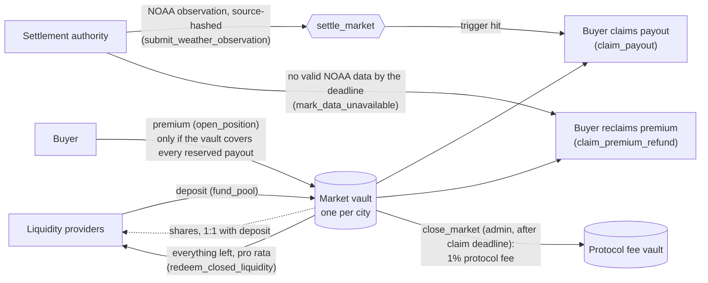
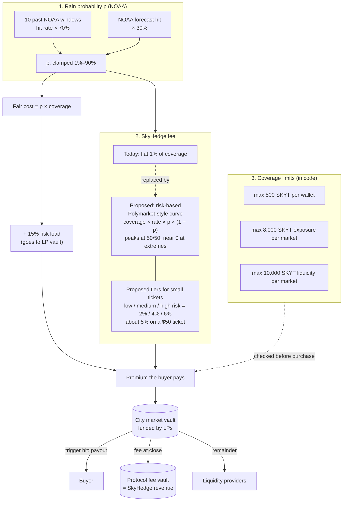
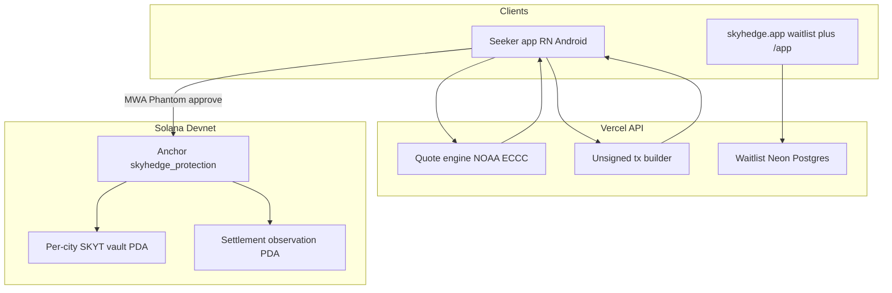

# SkyHedge: weather hedging you buy from your phone

> **Parametric weather hedging on Solana, for any person or business whose plans depend on the weather.** Pick a place and a weather risk, see a quote priced from NOAA data, approve it in your wallet, and collect a fixed on-chain payout with one tap when NOAA data shows the trigger was hit. No claims adjuster, no paperwork.
>
> **Encode Club Solana Hackathon 2026** entry · native React Native Android app (built for the Solana Seeker) · Solana Devnet · Mobile Wallet Adapter.

| | |
|---|---|
| Live site | **https://skyhedge.app** (waitlist) · **https://skyhedge.app/app** (Devnet product) |
| Hackathon | Encode Club Solana Hackathon 2026 · readiness checklist: [docs/encode-readiness.md](docs/encode-readiness.md) |
| Tracks | **Best Consumer App on Solana** (primary) · **Best Use of x402 on Solana** (`GET /api/x402/quote`, Devnet USDC; see below) |
| Repo | [msourial/SkyHedge-Sol](https://github.com/msourial/SkyHedge-Sol) |
| APK | See [Releases](https://github.com/msourial/SkyHedge-Sol/releases) (Devnet build; SHA-256 in the release notes). Local release path: `mobile/android/app/build/outputs/apk/release/app-release.apk` |
| Demo | `<<DEMO_VIDEO_URL>>` · script: [docs/demo-script.md](docs/demo-script.md) |
| Pitch deck | [docs/submission/skyhedge-encode-deck.pdf](docs/submission/skyhedge-encode-deck.pdf) · pack: [docs/submission/](docs/submission/) |
| Encode pack | Description, problem/solution, stack, Devnet status, team, links under [docs/submission/](docs/submission/) |
| Program (Devnet) | `5hGLEG1ts46iER4pfWnP1fMb8sG5nxSinNY1pjYnNPWx` |
| Test token | `SKYT` mint `3Y1SaGnJiPez3hkcHom2gimtVEm7W7R8imeRMPTUaK9g` (Devnet, no value) |

**On-chain proof:** a real `OpenPosition` purchase from the Seeker through Phantom, finalized on Devnet:
[`5TjACP1S…7qsPWycH`](https://explorer.solana.com/tx/5TjACP1ScQxXRP4GNpA5zXqxAHK2iCNvcETPx1z7rJ4qXPjMWXZ6qXgngHjrPGv9sVL1h6nGULmzwCiu7qsPWycH?cluster=devnet)

> **History:** SkyHedge was first built for the Solana Mobile **Clock In** hackathon (October 2026). That entry's notes remain in [docs/clock-in-readiness.md](docs/clock-in-readiness.md) and [docs/clock-in-submission-draft.md](docs/clock-in-submission-draft.md).

## For judges

**What it is.** SkyHedge sells parametric weather protection: a fixed payout that becomes claimable when public NOAA weather data crosses a threshold fixed before purchase (for example, at least 50 mm of rain in Des Moines over a 7-day window). There is no claims process; the data decides.

**Quick start.**
1. Open **https://skyhedge.app** (waitlist) or **https://skyhedge.app/app** (Devnet product). Or install the Android APK on a Seeker / Android phone ([Releases](https://github.com/msourial/SkyHedge-Sol/releases)).
2. Phantom → Settings → Developer Settings → **Testnet Mode** → Solana **Devnet**. Need Devnet SOL (fees) and SKYT (premiums).
3. Demo path: landing **Rain on your plans? Get paid.** → **Open web app** → Seeker **Markets** (New York **Open**) → **Protect** expiry **Nov 1 · W**, the priced trigger row, **100 SKYT** → Phantom `open_position` → coverage ticket and Wallet balance → NOAA final data or a DataUnavailable refund. Shot list: [docs/demo-script.md](docs/demo-script.md). Local edit target: `~/Documents/Codex/demo-assets/skyhedge-encode-demo.mp4`.
4. Without SKYT you can still browse markets, quotes, and live NOAA data.

**How Solana powers it.**
- **Anchor program** (`anchor/programs/skyhedge_protection`) holds every rule: market creation, pricing inputs, purchases, settlement, payouts and refunds.
- **Per-market vaults:** each city market has its own fully collateralized, PDA-owned token vault. A purchase is rejected unless the vault covers every reserved payout.
- **SKYT** is a valueless six-decimal Devnet test token used as collateral; no real money is involved.
- **Mobile Wallet Adapter + Phantom:** the server builds the transaction unsigned and the user approves it in Phantom on the phone. Nothing is signed without the user.
- **Settlement:** the final NOAA observation is normalized, hashed and committed on-chain; if the trigger is hit the buyer claims the payout, and if data is unavailable premiums are refundable. `settle_market` and `mark_data_unavailable` are permissionless once their on-chain gates pass; the Devnet program was upgraded with them on 16 Oct 2026 ([docs/devnet-ops.md](docs/devnet-ops.md)). See [How settlement works](#how-settlement-works-and-why-you-can-trust-it).

**Current live status (Devnet).**
- **Website:** https://skyhedge.app — Storm Glass waitlist; product UI at `/app`. MapTiler key configured in Vercel production. Waitlist: `DATABASE_URL` + migrations `0002`/`0003`, plus `ADMIN_TOKEN` / `IP_HASH_SALT` for export — see `docs/waitlist-backend.md`.
- **New York:** the Encode camera path. On 18 Oct 2026 the Seeker showed New York **Open**, with **Nov 1 · W** as the priced weekly expiry. Read the live row for the trigger, chance, and price. Do not copy a number from this README onto a later recording if the screen has moved.
- **Des Moines:** still has open Devnet windows in the status API. It is not the demo path.
- **Soon on the first Markets screen (18 Oct 2026):** Chicago, Miami, Dallas–Fort Worth, Los Angeles. Toronto stays closed. Wind, snow, and heat have no prices.

**x402 (Best Use of x402 track).** `GET /api/x402/quote` sells one NOAA rainfall quote with x402 V2 `exact` on Solana Devnet, paid in Devnet USDC. The facilitator at `https://x402.org/facilitator` verifies and settles, and pays the Solana fee, so the server stores no signing key. A submitted transfer that Devnet has not finalized yet is HTTP 202 `SETTLEMENT_PENDING`: the same payment is retried, not a second charge. Notes: `/developers`. Demo script: [docs/demo-script-x402.md](docs/demo-script-x402.md). The route returns `PAYMENT_NOT_CONFIGURED` until `X402_PAY_TO` is set. x402-paid WeatherXM data is still not used for settlement.

No traction numbers are claimed; SkyHedge is pre-launch.

## Why

Weather decides whether a harvest pays, a flight leaves, an outdoor event sells tickets, a street vendor makes the day's sales, or a crane lifts. Traditional weather cover is slow, paperwork-heavy, sold in large minimum sizes, and out of reach for most small operators. SkyHedge is **instant** (quote and buy in under a minute), **accessible** (a phone and a wallet are enough), and **fractional** (no minimum policy size).

SkyHedge is for anyone whose income or plans depend on the weather, individual or business:

- **Farmers** whose season depends on rainfall they can't control.
- **Events and venues** that lose ticket sales when it rains.
- **Aviation:** operators, flight schools and charters that lose revenue on weather days.
- **Street vendors and outdoor workers** whose day's earnings disappear in a storm.
- Also construction and mining crews that stop work in bad weather.

US cities first (NOAA station data), then worldwide as more national weather sources are added.

**Business model:** a **1% protocol fee** of the cover amount on every purchase, included in the quoted premium and shown on the ticket. See [Fees](#fees). SkyHedge is pre-launch, so no traction numbers are claimed.

## Key features

- **Protect flow:** an expiry chain. Pick a date such as **Nov 1 · W**, the one priced trigger row, and coverage of **50 / 100 / 250 / Max SKYT**. The button reads **Protect for … SKYT** only with a live price, then Phantom approves `open_position`.
- **Markets:** New York leads the Seeker list and shows **Open** while a window is selling. Toronto stays closed. Wind, snow, and heat have no prices.
- **Phantom via Mobile Wallet Adapter on Devnet:** the server builds the transaction unsigned, and the user approves it in their wallet. Nothing is signed without the user.
- **On-chain positions** through the Anchor program, **one per wallet per market window**. After purchase the app shows "You're protected" with the finalized status and an **Explorer link**.
- **Settlement:** the final observation is normalized, hashed and committed on-chain. If the trigger is hit, the buyer collects the fixed payout with one Phantom approval. If source data is unavailable after a 7-day grace period, the market resolves `DATA_UNAVAILABLE` and premiums are refundable. SkyHedge never makes up weather values.
- **Built for mobile networks:** API reads retry with timeouts. Balances are read directly from Solana RPC with a fallback to a second Devnet endpoint (genesis-hash checked). Friendly errors and an offline state with Retry replace endless spinners.

## How it works

```
Pick place + risk  →  NOAA / Environment Canada data  →  quote (premium, payout, chance)
      →  approve in wallet (MWA)  →  Anchor program on Devnet holds premium + vault
      →  final observation hashed on-chain  →  one-tap payout claim or premium refund
```

Pricing uses ten analogous NOAA windows plus a forecast signal, a 15% risk load and the 1% fee. Markets come from a per-market counter, and city, station and provider are stored as hashes, so **adding Toronto needs no program change** (see [docs/canadian-market-plan.md](docs/canadian-market-plan.md)).

## How settlement works (and why you can trust it)

Judges and users rightly ask: if SkyHedge's server posts the weather result, why trust it? Here is exactly what the program enforces, what SkyHedge does, and how to check it yourself. Every rule below is in `anchor/programs/skyhedge_protection/src/lib.rs`.

1. **The terms are fixed before you buy.** `create_market` stores the NOAA station (as a hash), the methodology hash, the exact observation window, the comparison (for example "at least") and the threshold in millimetres. The program has no instruction that edits these after creation, so the trigger you buy is the trigger that settles.
2. **The money is already in the vault.** Each market has its own PDA-owned vault funded by liquidity providers. `open_position` is rejected unless the vault, including your premium, covers every payout already promised. Your full payout is reserved at purchase. Payouts come from that vault, not from SkyHedge.
3. **The trigger is NOAA GHCN-Daily data.** After the window ends, the settlement worker (`server/services/settlement.ts`) reads NOAA's GHCN-Daily records for the market's station, rejects days that are missing or fail NOAA quality checks, and adds up the window's total. It never invents or fills in a value.
4. **The program checks the reading.** `submit_weather_observation` is accepted only if it is signed by the protocol's settlement authority, matches the market's station hash, methodology hash and exact window, is not negative, carries a non-zero SHA-256 hash of the NOAA records used, and arrives before the data deadline (window end plus 7 days).
5. **The result is deterministic.** `settle_market` compares the posted total with the fixed threshold. Anyone can call it once the observation exists; the worker sends both steps in one transaction.
6. **You collect.** If the trigger hit, the buyer approves `claim_payout` in Phantom and the payout moves from the vault to their wallet. The claim window is 30 days after the data deadline.
7. **No data means money back.** If no valid observation is posted by the data deadline, anyone can call `mark_data_unavailable`, every buyer can reclaim their full premium with `claim_premium_refund`, and the 1% protocol fee is waived.

**Check it yourself.** Each step is a Solana Devnet transaction with an event (`ObservationSubmitted`, `MarketSettled`, `PayoutClaimed`, `PremiumRefunded`) you can open on [Solana Explorer](https://explorer.solana.com/address/5hGLEG1ts46iER4pfWnP1fMb8sG5nxSinNY1pjYnNPWx?cluster=devnet). Compare the posted rainfall with NOAA's public daily record for the same station and dates on [NCEI](https://www.ncei.noaa.gov/cdo-web/).

**What is still trusted today.** The settlement authority (`AVe5ULAoAyDaXAPS7s2sAUJo7A2QmDuph9Nwyrm9v5Vh`) is a key run by SkyHedge. Solana enforces who may post and what shape the reading must have, but it cannot prove on its own that the number matches NOAA. On Devnet today the SkyHedge team runs this step. The program already supports rotating the authority with a two-step `propose_settlement_authority` / `accept_settlement_authority`. **Roadmap:** hand this role to a decentralized oracle feed (Switchboard or Pyth style) that reports the NOAA reading, so no single SkyHedge key decides an outcome. That is not built yet.

## Fees

What the program charges today is hard-coded in `anchor/programs/skyhedge_protection/src/lib.rs` (`RISK_LOADING_BPS = 1_500`, `PROTOCOL_FEE_BPS = 100`). There are no fee tiers in the program.

- **15% margin on the odds:** the rain probability from NOAA history is marked up by 15%. This part of the premium stays in the market vault for liquidity providers.
- **1% protocol fee:** 1% of the cover amount (the amount paid out if the trigger hits). It is part of the premium, held in the vault, and moved to the protocol fee vault only when the market closes. It is waived if the market ends as data unavailable.
- **Formula:** `premium_rate_bps = ceil(probability_bps × 1.15) + 100`, and `premium = ceil(cover × premium_rate_bps / 10,000)`. Probability is clamped between 1% and 90%.

**Worked example (live New York markets on Devnet):** a 20% chance gives `ceil(2,000 × 1.15) + 100 = 2,400` bps. On **100 SKYT** of cover you pay **24.00 SKYT**, of which **1.00 SKYT** is the protocol fee. If the trigger hits you collect **100 SKYT**; if not, the 23.00 SKYT stays with liquidity providers and the 1.00 SKYT goes to the protocol at close.

Risk-based fee tiers shown in the pricing diagram below are a modeling proposal only and would need a program upgrade.

## Money flow

Each city market has its own fully collateralized vault (a PDA-owned SPL token account). Liquidity providers take the other side of every protection position; there is no order book or outside counterparty. Everything below is enforced by `anchor/programs/skyhedge_protection/src/lib.rs`.



- **Funding.** Any wallet can `fund_pool` while a market is Draft or Open and before sales close, up to the market's liquidity cap; LP shares are 1:1 with SKYT deposited. `withdraw_liquidity` is allowed in the same window only if the vault still covers reserved exposure.
- **Buying.** `open_position` charges `premium = ceil(protected_amount × premium_rate_bps / 10,000)`, where `premium_rate_bps = ceil(probability_bps × 1.15) + 100`. The 1% protocol fee (1% of the protected amount) is part of the premium and is only accrued, not moved. The purchase reserves the full payout and is rejected unless the vault, including the new premium, covers all reserved exposure and stays within the market's exposure and per-wallet caps.
- **Settlement.** The settlement authority posts one NOAA observation that must match the market's station hash, methodology hash and window and carry a non-zero source hash. Once that observation exists, **anyone** may call `settle_market` (deterministic). If the trigger is hit, the buyer claims the payout; if not, premiums stay for LPs. After the data deadline with **no** observation, **anyone** may call `mark_data_unavailable` so buyers reclaim premiums (protocol fee waived). These permissionless paths are live on Devnet since the 16 Oct 2026 program upgrade ([docs/devnet-ops.md](docs/devnet-ops.md)).
- **Close.** After the claim deadline the admin calls `close_market`: the accrued 1% fee moves to the protocol fee vault (zero when data was unavailable) and everything left in the vault is redeemable by LPs pro rata.
- **Who signs.** The protocol admin wallet creates, opens (needs at least one LP share) and closes markets; the settlement authority posts observations; LPs and buyers sign their own deposits, purchases and claims. Funding is not admin-gated on chain; on Devnet the admin wallet seeds the first liquidity.
- **Collateral.** Devnet uses the valueless six-decimal SKYT test token; no real money is involved.

## Pricing model

**Live today:** premium rate = ceil(rain probability × 1.15) + 1% fee, charged on the coverage amount (see [Fees](#fees) for a worked example). Rain probability comes from NOAA: 70% from hits in the 10 matching past windows and 30% from the NOAA forecast, clamped between 1% and 90%. **Proposed (not yet in the program):** replace the flat 1% with a risk-based fee. Changing it needs an on-chain program update.



Payouts come from the liquidity providers' vault, not from SkyHedge. SkyHedge's revenue is only the fee, so it carries no weather risk unless it also provides liquidity. Limits come from `scripts/seed-markets.ts`, and the formula comes from `anchor/programs/skyhedge_protection/src/lib.rs` and `server/services/quote-engine.ts`. The fee tiers are a modeling proposal.

## Install

**APK:** download it from [Releases](https://github.com/msourial/SkyHedge-Sol/releases). A release for build `e5ca97a` is coming. Install with `adb install SkyHedge-ClockIn.apk` or sideload it on the Seeker.

**Wallet setup:** in Phantom, open Settings → Developer Settings, turn on **Testnet Mode**, and set Solana to **Devnet**. You need Devnet SOL for fees and SKYT for premiums.

**Build from source:**

```bash
npm install
npm run check          # typecheck (root)
npm run test:server    # server tests

cd mobile
npm install
npm run check          # typecheck (mobile)
npm run test:mobile    # mobile tests (see Tests below)
EXPO_PUBLIC_API_BASE_URL=https://skyhedge.app npx expo prebuild --platform android
cd android && EXPO_PUBLIC_API_BASE_URL=https://skyhedge.app ./gradlew assembleRelease
# → android/app/build/outputs/apk/release/app-release.apk
```

`EXPO_PUBLIC_API_BASE_URL` is baked in at build time and falls back to `https://skyhedge.app`. `EXPO_PUBLIC_SKYT_MINT` can override the SKYT mint. For the full developer reference (env vars, localnet, Devnet activation, API, security posture), see [docs/developer-reference.md](docs/developer-reference.md).

**Run the web app and API locally (Devnet, read-only until a wallet signs):**

```bash
cp .env.example .env      # optional; fill only what you need
SKYT_MINT=3Y1SaGnJiPez3hkcHom2gimtVEm7W7R8imeRMPTUaK9g npm run dev   # http://localhost:5000 (PORT overrides)
npm run build && npm start                                          # production bundle in dist/
```

Without `SKYT_MINT` the server reads status but will not prepare transactions. Without `SOLANA_RPC_URL` it falls back to the public Devnet RPCs, which rate-limit (HTTP 429); set a private Devnet RPC URL for anything beyond a quick check. `DATABASE_URL` and `NOAA_TOKEN` are optional: without them `/api/markets` reports the read model as deferred (open windows come from `/api/devnet/status`) and live NOAA weather reads return `DATA_UNAVAILABLE`.

## Tech stack

- **Mobile:** Expo / React Native (Android), `@solana-mobile/mobile-wallet-adapter-protocol-web3js`, `@solana/web3.js`
- **Chain:** Anchor program `skyhedge_protection` on Solana Devnet, SPL token SKYT
- **Server:** Node / Express (TypeScript): quote engine, NOAA and ECCC providers, evidence builder, unsigned-transaction builder, settlement runner. Deployed on Vercel.
- **Web:** React + Vite operator console

## Repo layout

```
mobile/    Expo / React Native Android app (Markets · Protect · Wallet), MWA, direct Solana RPC reads
server/    Express API: quote engine, NOAA + ECCC providers, evidence, unsigned-tx builder, settlement
anchor/    Anchor program skyhedge_protection (markets, vaults, positions, settlement, claims)
client/    Web companion / operator console (React + Vite), skyhedge.app
shared/    IDL, methodology, optional Postgres schema
docs/      demo script, pitch deck, submission draft, plans, takeover log
```

## Architecture (high level)



## Oracle failure handling

| Failure | Behavior |
| --- | --- |
| Incomplete / flagged NOAA days | Rejected off-chain; never synthesized into rainfall |
| No valid observation by `data_deadline` | `mark_data_unavailable` (permissionless after deadline) → buyers `claim_premium_refund` |
| Observation posted but settle stalled | `settle_market` permissionless once observation PDA exists |
| API / parser outage | Fail-closed; cron retries; 503 guidance — no alternate settlement source |
| NOAA revises after settle | Settled markets are final (7-day data grace before deadline; no reopen path in V1) |

Details: [docs/oracle-failure-plan.md](docs/oracle-failure-plan.md).

## Tests

```bash
npm run check                 # root typecheck
npm run test:server           # quote, NOAA/ECCC, waitlist, settlement
npm run test:ui               # Playwright (npx playwright install chromium once)
cd mobile && npm run check && npm run test:mobile
npm run solana:test           # cargo-build-sbf + Anchor Rust tests (incl. permissionless_resolution)
```

## Status & honesty

Devnet only. SKYT is a test token. SkyHedge is a parametric weather hedge and not a regulated product. No traction numbers are claimed. Encode team: **solo**.

## License

[MIT](LICENSE)
